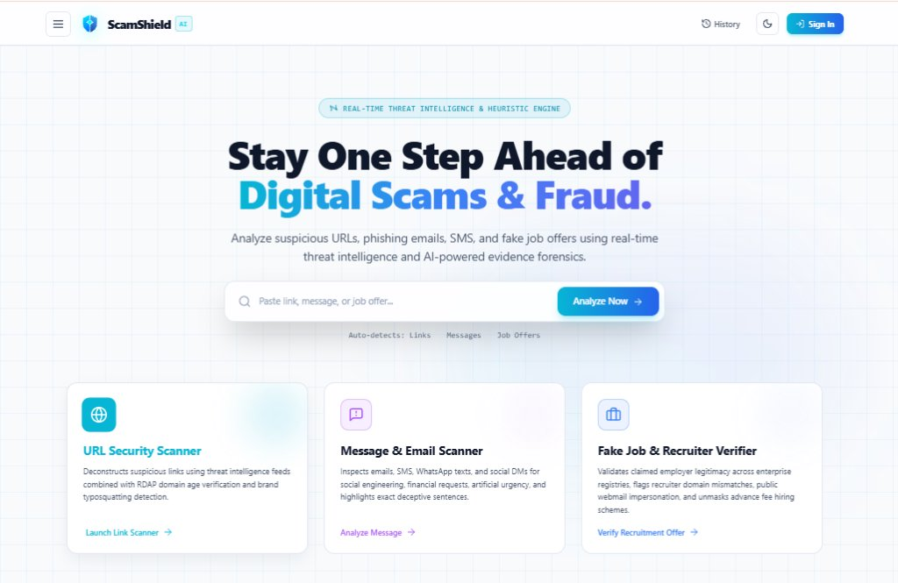

<div align="center">

  

  # ScamShield AI
  ### CYBERSECURITY THREAT OPERATIONS & FRAUD INTELLIGENCE PLATFORM

  **Unified Threat Detection & Forensic Analysis for Malicious Links, Phishing Clones, & Digital Deception**

  <br />

  [](https://scamshield-ai-weld-pi.vercel.app)
  <br />
  
  [](https://github.com/MuhammadAreebKhadim/scamshield_ai/stargazers)
  [](https://github.com/MuhammadAreebKhadim/scamshield_ai/network/members)
  [](https://github.com/MuhammadAreebKhadim/scamshield_ai/issues)
  [](LICENSE)
  <br />

  [](https://groq.com)
  [](https://www.virustotal.com)
  [](https://safebrowsing.google.com)
  [](https://urlhaus.abuse.ch)
  [](https://nextjs.org)
  [](https://python.org)
  [](https://sqlite.org)
  [](https://developers.google.com/identity)

</div>

---

<p align="center">
  
</p>

---

## Table of Contents
1. [Overview](#overview)
2. [System Architecture](#system-architecture)
3. [End-to-End Workflow & Processing Pipeline](#end-to-end-workflow--processing-pipeline)
4. [Core Platform Features](#core-platform-features)
5. [Technology Stack](#technology-stack)
6. [URL Detection Methodology & Key Identification Areas](#url-detection-methodology--key-identification-areas)
7. [Risk Scoring Model & Consistency Validation](#risk-scoring-model--consistency-validation)
8. [Getting Started & Local Development](#getting-started--local-development)
9. [Production Deployment](#production-deployment)
10. [License](#license)

---

## Overview

ScamShield AI is an intelligent fraud detection and cybersecurity intelligence platform designed to neutralize evolving online threats. While conventional filters issue generic and opaque blocks, ScamShield AI delivers comprehensive forensic dossiers breaking down exact evidence: domain age telemetry, vendor flag ratios, deceptive sentence highlights, and defensive remediation protocols.

- **Production URL**: [https://scamshield-ai-weld-pi.vercel.app](https://scamshield-ai-weld-pi.vercel.app)

---

## System Architecture

The ScamShield AI platform follows a decoupled micro-architecture separating the cyber-themed Next.js 15 frontend from the high-throughput Python threat inspection engine:

```
                                      CLIENT BROWSER
                                            │
                                            ▼
                             NEXT.JS 15 CYBER DASHBOARD
                         (App Router, React 19, Tailwind CSS)
                                            │
                           REST API Calls (Bearer JWT / CORS)
                                            │
                                            ▼
                             PYTHON FAST FORENSIC ENGINE
                              (Flask / ThreadPoolExecutor)
                                            │
               ┌────────────────────────────┼────────────────────────────┐
               │                            │                            │
               ▼                            ▼                            ▼
      URL SECURITY SCANNER         MESSAGE & SMS SCANNER        JOB OFFER VERIFIER
   (Punycode, RDAP, DNS, IP)       (Multi-Channel Regex)      (Corporate Portal Index)
               │                            │                            │
               └────────────────────────────┼────────────────────────────┘
                                            │
                                            ▼
                               THREAT INTELLIGENCE LAYER
               ┌────────────────────────────┼────────────────────────────┐
               ▼                            ▼                            ▼
            URLhaus                    VirusTotal              Google Safe Browsing
         (abuse.ch API)                 (API v3)                     (API v4)
               │                            │                            │
               └────────────────────────────┼────────────────────────────┘
                                            │
                                            ▼
                                  AI CONTEXTUAL FORENSICS
                                (Groq LLaMA-3.3 / GPT-OSS)
                                            │
                                            ▼
                               CONSISTENCY VALIDATION ENGINE
                             (Evidence Flooring & Scoring 0-100)
                                            │
                                            ▼
                               SQLITE PERSISTENCE STORE
                         (Audited Scans & User Data Isolation)
```

---

## End-to-End Workflow & Processing Pipeline

1. **Ingestion & Sanitization**:
   The client submits untrusted telemetry (a URL, message body, or recruitment claim). The API layer validates, sanitizes, and normalizes inputs to mitigate injection vectors.

2. **Parallelized Execution**:
   The engine initializes a multi-threaded execution worker pool (`ThreadPoolExecutor`), fanning out synchronous and asynchronous inspections in parallel to maximize throughput:
   - Structural and lexical rule analyzers.
   - RDAP domain registry and DNS lookups.
   - Upstream multi-vendor threat intelligence checks.
   - Contextual LLM reasoning via Groq Cloud.

3. **Threat Feed Aggregation**:
   External threat telemetry from abuse.ch URLhaus, VirusTotal v3, and Google Safe Browsing v4 are aggregated, normalized, and mapped to standard MITRE ATT&CK and anti-fraud classifications.

4. **Algorithmic Risk Scoring & Consistency Flooring**:
   The Weighted Risk Engine computes a deduplicated score between 0 and 100. The Consistency Validation layer evaluates cross-engine findings to enforce mathematical floors against critical indicators (e.g. advance fee demands with domain mismatches or credential harvesting on raw IP hosts).

5. **Telemetry Persistence & Reporting**:
   The unified scan record is committed to SQLite, isolated per user account, and immediately rendered as a comprehensive audit report.

---

## Core Platform Features

- **Security Operations Center (SOC) Dashboard**:
  Live metrics, severity distributions, real-time threat category tracking, and user audit history.
- **URL & Domain Security Scanner**:
  Deconstructs URL architecture, queries external threat intelligence databases, identifies lookalikes, and performs recursive inspections.
- **Message & Social Engineering Scanner**:
  Multi-channel analysis (Email, SMS, WhatsApp, Social DMs) with recursive embedded link scanning and interactive flagged sentence highlighting.
- **Fake Job & Recruiter Offer Verifier**:
  Cross-references recruiter domains with official corporate registries, validates active career portal vacancies, and checks enterprise fee policies.
- **Forensic Audit Dossiers**:
  Detailed PDF-printable security reports (`SC-XXXXXX`) featuring full signal calculation breakdowns and defensive recommendations.
- **User History Registry**:
  Authenticated personal scan history with real-time database partitioning, search, filter by risk tier, and export capabilities.
- **Theme Flexibility & Cyber Aesthetic**:
  Designed to SOC standards with dark and light themes, strict zero-emoji interface compliance, and precision SVG iconography.

---

## Technology Stack

### Frontend Architecture
- **Framework**: Next.js 15 (App Router, Server & Client Components)
- **Library**: React 19
- **Language**: TypeScript
- **Styling**: Tailwind CSS with custom cyber-security palette
- **Icons**: Lucide React (Strict Zero-Emoji compliance)
- **Authentication**: Google Identity Services (GIS) & JWT Session Management

### Backend Architecture
- **Runtime**: Python 3.12
- **Web API**: Flask with Flask-CORS
- **Concurrency**: `concurrent.futures.ThreadPoolExecutor`
- **Database**: SQLite3 with thread-safe relational partitioning
- **Authentication**: PyJWT (HMAC-SHA256 tokens) & Google OAuth Client SDK

### Threat Intelligence & External APIs
- **URLhaus API (`abuse.ch`)**: Real-time malware payload tracking
- **VirusTotal API (`v3`)**: Multi-vendor antivirus URL reputation
- **Google Safe Browsing API (`v4`)**: Threat lists for malware and social engineering
- **Groq AI**: High-speed forensic inference (LLaMA-3.3 70B Versatile, GPT-OSS 120B)

---

## URL Detection Methodology & Key Identification Areas

ScamShield AI employs a multi-tiered, defense-in-depth inspection pipeline to identify fraudulent, malicious, and deceptive URLs. The system evaluates URLs across the following critical identification vectors:

### 1. Structural Decomposition & Lexical Analysis
- Deconstructs raw URLs into protocol, fully qualified domain name (FQDN), registered domain, subdomain hierarchy, path, and query strings using `urllib.parse` and Mozilla's Public Suffix List via `tldextract`.
- Evaluates token entropy and scans hostnames, subdomains, and URL paths against dictionaries of high-risk credential-harvesting keywords (`login`, `secure`, `verify`, `banking`, `recovery`, `2fa`, `wallet`, `kyc`).

### 2. Punycode & Homoglyph Lookalike Detection
- Identifies Internationalized Domain Names (IDNs) and decodes Punycode (`xn--`) labels.
- Scans domains for cross-script homoglyph spoofing attacks (e.g. replacing Latin characters with visually identical Cyrillic, Greek, or Unicode glyphs such as substituting Latin `a` with Cyrillic `а` / `U+0430`).
- Alerts users with high-severity indicators when non-ASCII scripts are mixed inside domain labels.

### 3. Brand Impersonation & Typosquatting Analysis
- Analyzes candidate domains against an extensive database of high-value brands (Google, Microsoft, Apple, PayPal, Binance, Amazon, Meta, Wells Fargo, etc.).
- Computes Levenshtein edit distance and token similarity algorithms to catch subtle character insertions, deletions, or transpositions.
- Detects subdomain spoofing patterns where authentic brand names are embedded inside subdomains of unrelated registered domains (e.g., `login.google.com.attacker-domain.xyz`).

### 4. URL Shortener Detection & Safe Unshortening
- Identifies common link compression services (such as `bit.ly`, `tinyurl.com`, `t.co`, `goo.gl`, `ow.ly`, `is.gd`, `rb.gy`).
- Queries the short link using isolated HTTP `HEAD`/`GET` redirect inspection to safely trace the final destination target before running downstream analysis.

### 5. Direct IP Host & Private vs. Public Address Classification
- Detects URLs where a raw IPv4 or IPv6 address is utilized instead of a legitimate domain name.
- Inspects the IP address against IANA RFC 1918 and loopback address specifications:
  - **Private IPv4 Host**: Immediately classified (e.g. `192.168.x.x`, `10.x.x.x`, `172.16.x.x`) to prevent local network scanning and intranet phishing.
  - **Public Routable IP**: Assessed for unencrypted credential collection (e.g. raw HTTP login portals).

### 6. Protocol & Encryption Verification
- Separates transport encryption (HTTPS vs. HTTP) from domain authenticity.
- Flags unencrypted HTTP endpoints on credential-sensitive routes while verifying that HTTPS presence is never treated as a sole indicator of legitimacy.

### 7. RDAP Domain Age & Registration Telemetry
- Queries authoritative Registration Data Access Protocol (RDAP) endpoints to extract creation, modification, and registrar timestamps.
- Flags freshly registered domains (<30 days old) as elevated risk vectors, as ephemeral phishing infrastructure is frequently registered hours before an active campaign.
- Gracefully handles missing or unlisted registry records without false negative classification.

### 8. DNS Record & Host Resolution Verification
- Probes authoritative DNS records (`A`, `AAAA`, `MX`, `NS`, `TXT`) to verify domain routing.
- Detects non-existent domains (`NXDOMAIN`) and identifies suspicious transactional domains that lack basic mail exchange (`MX`) records.

### 9. Multi-Vendor Threat Intelligence Telemetry
- **URLhaus (`abuse.ch`)**: Queries live malware distribution registries for active payload links.
- **VirusTotal (`v3`)**: Aggregates 60+ commercial security vendor verdicts, displaying precise detection ratios (`X/60 Vendors Flagged`).
- **Google Safe Browsing (`v4`)**: Cross-references Google's database for social engineering, malware, and deceptive software warnings.

---

## Risk Scoring Model & Consistency Validation

The composite risk score (0 to 100) reflects evidence-weighted contributions calculated from all detection layers:

| Signal Factor | Weight Range | Forensic Condition |
| :--- | :---: | :--- |
| Threat Feed Match (URLhaus / Google Safe Browsing) | +40 to +60 pts | Confirmed active malware or phishing threat |
| Multi-Vendor Detections (VirusTotal) | +5 to +35 pts | Scaled vendor flag count |
| Direct IP Host Usage | +15 to +25 pts | Raw numeric IP host (escalated for private subnet targets) |
| Brand Typosquatting / Homoglyph Spoof | +15 to +25 pts | Visual or lexical impersonation of verified enterprise |
| Unencrypted HTTP Protocol | +10 to +15 pts | Plaintext data transmission |
| Recently Registered Domain (<30 days) | +10 to +15 pts | Newly minted disposable infrastructure |
| High-Risk Lexical Keyword Triggers | +5 to +10 pts | Credential harvesting keywords detected |
| AI Contextual Forensic Blend | +10 to +25 pts | Natural language intent and deceptive framing |

### Risk Tiers
- **0 – 19 (LOW / SAFE)**: No adverse signatures detected; verified clean infrastructure.
- **20 – 39 (CAUTION)**: Low-confidence or isolated anomalies present (e.g. standard login keywords).
- **40 – 69 (SUSPICIOUS)**: Multiple heuristic indicators flagged (e.g. unshortened link to young domain).
- **70 – 100 (HIGH RISK)**: Confirmed active threats, critical homoglyphs, or severe credential harvesting.

---

## Getting Started & Local Development

### Prerequisites
- Node.js 18+ and npm
- Python 3.10+
- Git

### Backend Setup
```bash
# Clone the repository
git clone https://github.com/MuhammadAreebKhadim/scamshield_ai.git
cd scamshield_ai

# Setup Python environment
python -m venv backend/venv
backend/venv/Scripts/activate  # On Windows
# source backend/venv/bin/activate  # On macOS/Linux

# Install dependencies
pip install -r backend/requirements.txt

# Run backend API
python backend/main.py
```
Backend API will start on `http://127.0.0.1:8000`.

### Frontend Setup
```bash
# Navigate to frontend
cd frontend

# Install dependencies
npm install

# Run development server
npm run dev
```
Frontend dashboard will be running on `http://localhost:3001` (or `http://localhost:3000`).

---

## Production Deployment

The platform is deployed live on Vercel:

- **Primary URL**: [https://scamshield-ai-weld-pi.vercel.app](https://scamshield-ai-weld-pi.vercel.app)

---

## 📄 License

Distributed under the **MIT License**. See [`LICENSE`](LICENSE) for complete details.

---

<div align="center">
  <sub>Developed by <a href="https://github.com/MuhammadAreebKhadim">Muhammad Areeb Khadim</a>. Built for researchers, scientists, and engineers worldwide.</sub>
</div>
